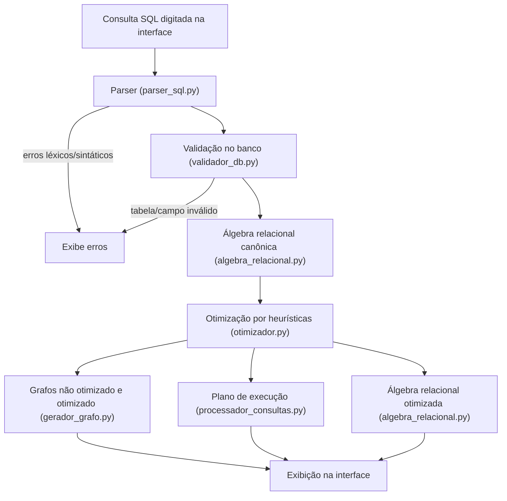

# Processador de Consultas SQL

Trabalho da disciplina de Banco de Dados: um processador de consultas com interface gráfica. Ele recebe uma consulta SQL, faz o parse e a validação contra o banco `BD_Vendas`, converte para álgebra relacional, aplica heurísticas de otimização, desenha os grafos de operadores (original e otimizado) e mostra o plano de execução.

## Funcionalidades

- **Interface gráfica** (Tkinter) com campo para digitar a consulta SQL
- **Parser** com expressões regulares para `SELECT`, `FROM`, `WHERE`, `INNER JOIN ... ON`
- **Validação léxica e sintática** dos comandos e operadores (`=`, `>`, `<`, `<=`, `>=`, `<>`, `AND`, `(`, `)`)
- **Validação semântica** de tabelas e campos contra o schema do MySQL
- **Conversão para álgebra relacional** (expressão original e otimizada)
- **Grafo de operadores não otimizado e otimizado** exibidos na interface
- **Heurísticas de otimização**:
  - redução de tuplas (seleções empurradas para as folhas)
  - redução de atributos (projeções empurradas para as folhas)
  - reordenação das folhas priorizando tabelas com menor quantidade de registros
  - eliminação de produtos cartesianos
- **Plano de execução** com a ordem das operações e os resultados intermediários
- **Suporte a dados mockados** para demonstrar variações de custos e ordens de execução

## Estrutura do Projeto

| Arquivo | Responsabilidade |
|---|---|
| `main.py` | Interface gráfica e orquestração do fluxo de processamento |
| `parser_sql.py` | Parse da string SQL e validação léxica/sintática |
| `validador_db.py` | Validação de tabelas/campos no `BD_Vendas`, contagem de registros e qualificação (`Tabela.campo`) |
| `dados_mock.py` | Contagens simuladas de registros e flag para alternar entre dados reais do MySQL e mock |
| `algebra_relacional.py` | Conversão para álgebra relacional (canônica e otimizada) |
| `otimizador.py` | Aplicação das heurísticas de otimização |
| `gerador_grafo.py` | Desenho dos grafos de operadores no canvas |
| `processador_consultas.py` | Construção do grafo em memória e geração do plano de execução |

## Fluxo de Processamento



## Validações Realizadas

**Parser (léxico/sintático)**
- A consulta deve começar com `SELECT` e conter `FROM`
- Campos e tabelas vazios (ex.: vírgula sobrando) são rejeitados
- `INNER JOIN` sem tabela e `ON`/`WHERE` sem condição são rejeitados
- Parênteses desbalanceados
- Símbolos inválidos (ex.: `!=`, `==`, `#`)
- Operadores fora do escopo do trabalho: `OR`, `NOT`, `LIKE`, `IN`, `BETWEEN`, `IS`, `NULL`

**Banco de dados (semântico)**
- Existência das tabelas no schema `BD_Vendas`
- Campos do `SELECT`, `ON` e `WHERE`:
  - `Tabela.campo`: a tabela precisa fazer parte da consulta e o campo precisa pertencer a ela
  - `campo`: precisa existir em exatamente uma das tabelas da consulta (caso contrário, é **ambíguo**)
- Falha de conexão com o banco

## Heurísticas de Otimização

### 1. Redução de tuplas (seleção)
Cada condição do `WHERE`/`ON` que envolve só uma tabela vira uma seleção `σ` posicionada logo acima da tabela correspondente. Assim as tuplas são filtradas antes das junções.

### 2. Redução de atributos (projeção)
Para cada tabela é criada uma projeção `π` com apenas os atributos usados no `SELECT` final ou nas condições de junção/seleção.

### 3. Tabelas menores primeiro (Cardinalidade / Restritividade)
As folhas da árvore são reordenadas pela **quantidade de registros** de cada tabela no banco de dados (abordagem *Cost-Based*):
- Tabelas com menos tuplas são processadas no início da árvore de junção para minimizar o tamanho dos resultados intermediários.
- A contagem de registros pode vir diretamente do MySQL via `COUNT(*)` ou ser simulada através do arquivo `dados_mock.py` para fins de demonstração acadêmica.

### 4. Evitar produto cartesiano
A árvore é montada de forma gulosa (*left-deep*): inicia-se pela tabela com menor número de registros. A cada passo, escolhe-se entre as tabelas restantes aquela que possui menor cardinalidade **e que tenha predicado de junção** com as tabelas já integradas. O produto cartesiano (`X`) só aparece quando nenhuma condição liga as tabelas restantes.

## Plano de Execução

O grafo otimizado é construído em memória como uma árvore de nós `NoOperador` e percorrido em **pós-ordem**, ou seja, cada operador só é executado depois dos seus filhos. Cada operação gera um resultado intermediário `R1, R2, ...`.

Exemplo de saída:

```
1. [Seleção]  R1 ← σ Status.idStatus = 1 (Status)
2. [Projeção] R2 ← π Status.idStatus (R1)
3. [Projeção] R3 ← π Pedido.Cliente_idCliente, Pedido.Status_idStatus, Pedido.idPedido (Pedido)
4. [Junção]   R4 ← R2 ⨝ Status.idStatus = Pedido.Status_idStatus R3
5. [Projeção] R5 ← π Cliente.Nome, Cliente.idCliente (Cliente)
6. [Junção]   R6 ← R4 ⨝ Cliente.idCliente = Pedido.Cliente_idCliente R5
7. [Projeção] R7 ← π Cliente.Nome, Pedido.idPedido (R6)
Resultado final: R7
```

## Instalação e Execução

### Pré-requisitos
- Python 3.10+
- MySQL com o schema `BD_Vendas` criado (scripts fornecidos no enunciado do trabalho)

### Passos

1. Crie e ative o ambiente virtual:
   ```powershell
   python -m venv venv
   .\venv\Scripts\Activate.ps1
   ```
2. Instale as dependências:
   ```powershell
   pip install mysql-connector-python python-dotenv
   ```
3. Configure as credenciais do MySQL:
   Como o arquivo `.env` está no `.gitignore` por segurança, ao executar o projeto em outra máquina (como na máquina do professor/avaliador), é **obrigatório** criar ou configurar o arquivo `.env` na raiz do projeto com as credenciais do MySQL Workbench local:
   ```env
   DB_USER=root
   DB_PASSWORD=sua_senha_do_workbench
   ```
   *(Você pode renomear ou copiar o arquivo `.env.example` para `.env` e preencher sua senha).*

   > [!IMPORTANT]
   > Se o `.env` não for configurado ou a senha estiver incorreta para a instância local do MySQL, a validação acusará erro de conexão com o banco `BD_Vendas`.

4. (Opcional) Configuração de Dados Mockados:
   No arquivo `dados_mock.py`, é possível ativar ou desativar simulações de cardinalidade alterando a variável `USAR_MOCK = True` (ou `False`) e editando as contagens de registros das tabelas para demonstrar a alternância da ordem das árvores de consulta.

5. Execute a aplicação:
   ```powershell
   python main.py
   ```

## Exemplos de Consultas

**Consulta válida com junções e seleção**
```sql
SELECT Cliente.Nome, Pedido.idPedido, Status.Descricao FROM Cliente
INNER JOIN Pedido ON Cliente.idCliente = Pedido.Cliente_idCliente
INNER JOIN Status ON Status.idStatus = Pedido.Status_idStatus
WHERE Status.idStatus = 1
```
Se `Status` tiver menos registros que `Cliente` (ex: 3 vs 500), a ordem otimizada será: `Status → Pedido → Cliente`, sem produto cartesiano.

**Demonstração de alternância de cardinalidade**
```sql
SELECT Produto.Nome, Categoria.Descricao FROM Produto
INNER JOIN Categoria ON Produto.Categoria_idCategoria = Categoria.idCategoria
```
- Se `Categoria` tiver menos registros que `Produto`, a ordem será `Categoria → Produto`.
- Se `Produto` tiver menos registros, a ordem se inverte para `Produto → Categoria`.

**Consultas inválidas**

| Consulta | Erro |
|---|---|
| `SELEC * FROM Produto` | A consulta deve começar com SELECT |
| `SELECT Nome FROM Produto WHERE Preco != 10` | Símbolo inválido `!` |
| `SELECT Nome FROM Produto WHERE Preco > 1 OR Preco < 5` | Operador não suportado `OR` |
| `SELECT Produto.Email FROM Produto` | `Email` não pertence a `Produto` |
| `SELECT Nome FROM Cliente INNER JOIN Produto ON ...` | `Nome` é ambíguo |

## Banco de Dados Exemplo (BD_Vendas)

| Tabela | Campos |
|---|---|
| Categoria | idCategoria, Descricao |
| Produto | idProduto, Nome, Descricao, Preco, QuantEstoque, Categoria_idCategoria |
| TipoCliente | idTipoCliente, Descricao |
| Cliente | idCliente, Nome, Email, Nascimento, Senha, TipoCliente_idTipoCliente, DataRegistro |
| TipoEndereco | idTipoEndereco, Descricao |
| Endereco | idEndereco, EnderecoPadrao, Logradouro, Numero, Complemento, Bairro, Cidade, UF, CEP, TipoEndereco_idTipoEndereco, Cliente_idCliente |
| Telefone | Numero, Cliente_idCliente |
| Status | idStatus, Descricao |
| Pedido | idPedido, Status_idStatus, DataPedido, ValorTotalPedido, Cliente_idCliente |
| Pedido_has_Produto | idPedidoProduto, Pedido_idPedido, Produto_idProduto, Quantidade, PrecoUnitario |

## Atendimento aos Critérios de Avaliação

| Critério | Nota | Onde |
|---|---|---|
| Interface gráfica existente e funcional | 1,5 | `main.py` |
| Local para inserir a string com a consulta SQL | 1,0 | `main.py` |
| A string é parseada | 1,0 | `parser_sql.py` |
| Campos e comandos errados são validados | 1,0 | `parser_sql.py`, `validador_db.py` |
| Grafo otimizado de operadores mostrado na GUI | 1,0 | `gerador_grafo.py` |
| Ordem de execução da consulta (plano de execução) | 1,5 | `processador_consultas.py` |
| Heurística de redução de tuplas apresentada no grafo | 1,0 | `otimizador.py`, `gerador_grafo.py` |
| Heurística de redução de atributos apresentada no grafo | 1,0 | `otimizador.py`, `gerador_grafo.py` |
| Demais heurísticas | 1,0 | `otimizador.py` |

## Limitações

- Não há suporte a aliases de tabelas (`FROM Cliente c`) nem a `OR`, `LIKE`, `IN`, subconsultas, `GROUP BY` ou `ORDER BY`, conforme o escopo do trabalho
- Datas e textos devem estar entre aspas (`'2020-01-01'`)
